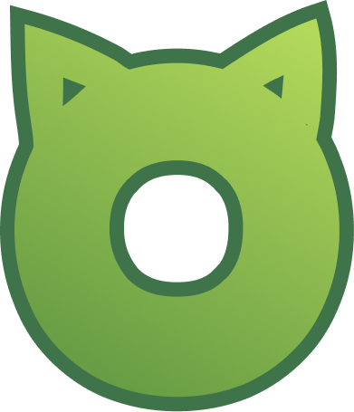
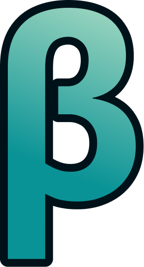

# Бейджики

Они дают возможность отличиться от остальных пользователей

### 🎩 Значки команды


{% column width="16.666666666666664%" valign="middle" %}

<figure><figcaption></figcaption></figure>



{% column width="83.33333333333334%" valign="middle" %}
#### 🎩 Значок команды бота

Выдается всей команде бота: Модераторам, администраторам, разработчикам, сотрудникам поддержки и др.



### ✨ Пользовательские значки


{% column width="16.666666666666664%" valign="middle" %}
<figure><figcaption></figcaption></figure>


{% column width="83.33333333333334%" valign="middle" %}
#### 🅰️ Значок альфа-тестера

Выдавался всем, кто пользовался ботом до 7 июля 2026 года



***


{% column width="16.666666666666664%" %}
<figure><figcaption></figcaption></figure>


{% column width="83.33333333333334%" valign="middle" %}
#### 🅱️ Значок бета-тестера

Будет выдаваться до тех пор, пока планируемый функционал не будет реализован в полной мере и не выйдет первая релизная версия — **v1.0.0**



