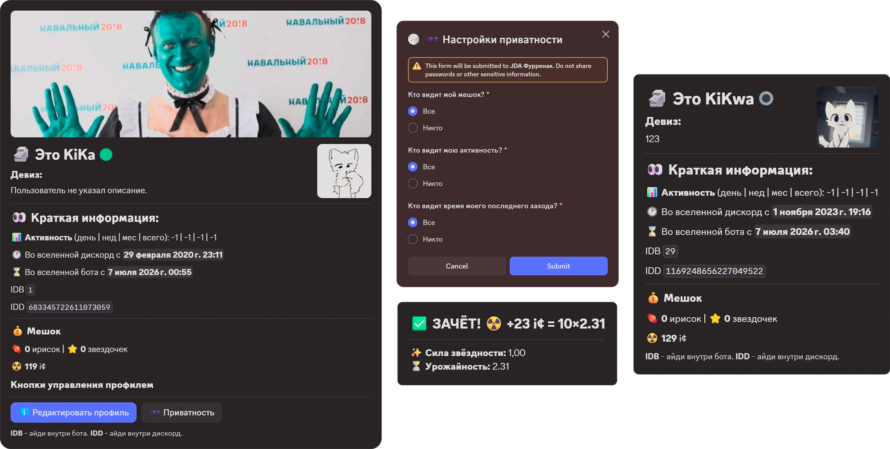

# Discord bot - smlly#6593

<figure><figcaption></figcaption></figure>

## ☁️ Использование готового бота

Добавьте его к себе на сервер по ссылке — [тык](https://discord.com/oauth2/authorize?client_id=873596380659191859\&permissions=8\&integration_type=0\&scope=bot)

Из базы нужно знать:

* Бот поддерживает команды с префиксами —  `!`, `.` и `ирис`&#x20;
* Посмотреть список команд бота — `хелп`. В более удобном виде в [документации](https://app.gitbook.com/s/KRGWIbmi5OF1gAPIJIkd/nachat-polzovatsya)
* Сообщить об ошибках можно в [issues](https://github.com/KiKaaad/smllyBot/issues) на гитхабе. Как правильно создавать сообщения о них [написано в проекте](https://github.com/KiKaaad/smllyBot/issues)
* Получить поддержку по боту можно:
  * У владельца - [t.me/kikaaad](https://t.me/KiKaaad)
  * В нашем дискорд-сервере, в канале поддержки — [discord.gg/3JSz5fEeee](https://discord.gg/3JSz5fEeee)

## ✈️ Собственный хостинг бота

Загрузите последний его релиз со страницы гитхаба  - [github.com/KiKaaad/smllyBot/releases](https://github.com/KiKaaad/smllyBot/releases)

Для успешного запуска вам понадобится:

1. **☕ Java 25** и более
2. **🗂️ PostgreSQL — база данных**



### Запустите бота в первый раз

Команда запуска - `java -Xms128M -Xmx4096M название_вашего_файла.jar`\
-Xms это минимум выделяемой ОЗУ\
-Xmx это максимум потребляемой ОЗУ\
Эти значения лучше всего должны быть одинаковыми

Пример полной команды:\
`java -Xms128M -Xmx4096M smllybot-0.7.0-beta.jar`&#x20;



### Настройте `config.toml`

При первом запуске возникнет ошибка. Это нормально!

Нужно заполнить файл конфигурации, обязательные поля помечены

Одни из них это:  токен, название базы данных, пароль от юзера базы данных



### Вновь повторите запуск

Если бот вывел что-то типо такого:

```log
[14:59:51] [JDA MainWS-ReadThread | INFO]:
Информация JDA:
🐾 Версия: 6.7.0_7c90001
🐾 Гитхаб: https://github.com/discord-jda/JDA
Информация бота:
ℹ️ Префиксы: !][.
💾 Версия: v0.7.1-beta (27.09.2026)
📎 Гитхаб: https://github.com/KiKaaad/smllyBot
🌚 Работает на боте: femboy#6593 | 🆔 ID: 873596380659191859
🔗 Шардов всего (1 шард = 0 - 2.500 серверов): 1
🌃 Серверов: 17
💀 Пользователей: 666
✅ Успешно запущено
```

Все хорошо, можете пользоваться собственным ботом 🎉



### 🍕  Почему я решил создать этого бота

Проект создан в рамках моего обучения программированию. Как первый язык я выбрал **Java**, для меня оно показалось чем-то средним, между абстрагированными языками как **Python** или **JavaScript** и низкоуровневыми как **C++** или **Rust**.&#x20;

Также мне всегда хотелось использовать Iris в качестве удобного бота в своем дискорд-сервере т. к он сочитал в себе все самое базовое и нужное, но в дискорде его не было _и как говорил Иван Иванов его и не будет, вроде бы..._

Воспользовавшись идеей ириски я решил самостоятельно реализовать его. \
В идеях у меня сделать одного бота для нескольких платформ, пока что это Telegram и Discord и так, чтобы статистику и настройки можно было связать между двумя совершенно разными сервисами.&#x20;

_Мяу 🐾_

### ❔ Возможные вопросы и проблемы

<details>

<summary>Появились страшные и не понятные символы</summary>

Так как я не знаю английский столь хорошо, чтобы писать на нем, я использую русский язык в логах. Терминалы не любят его, поэтому попробуйте прописать перед запуском команду: `[console]::outputEncoding = [System.Text.Encoding]::UTF8`

Это должно решить проблему

</details>

<details>

<summary>Как часто выходят обновления?</summary>

Примерно **\~2 раза в месяц**. Чем больше у меня свободного времени, тем чаще обновления.&#x20;

На это влияют:

* Мой интерес в изучении Java & Kotlin. Кроме них я изучаю еще веб и низкоуровневый Rust, а еще накладные типа SQL и фреймворки
* Количество свободного времени, а я еще студент 😭&#x20;

</details>

<details open>

<summary>Когда бот выйдет из беты в релиз</summary>

Когда появится основной функционал, который не будет мешать другим ботам и не будет иметь критических ошибок

Модули которые 100% будут сделаны до полного релиза:

* Анкеты и профили
* Модерация
* Настройки гильдии
* Статистика и топы

</details>
